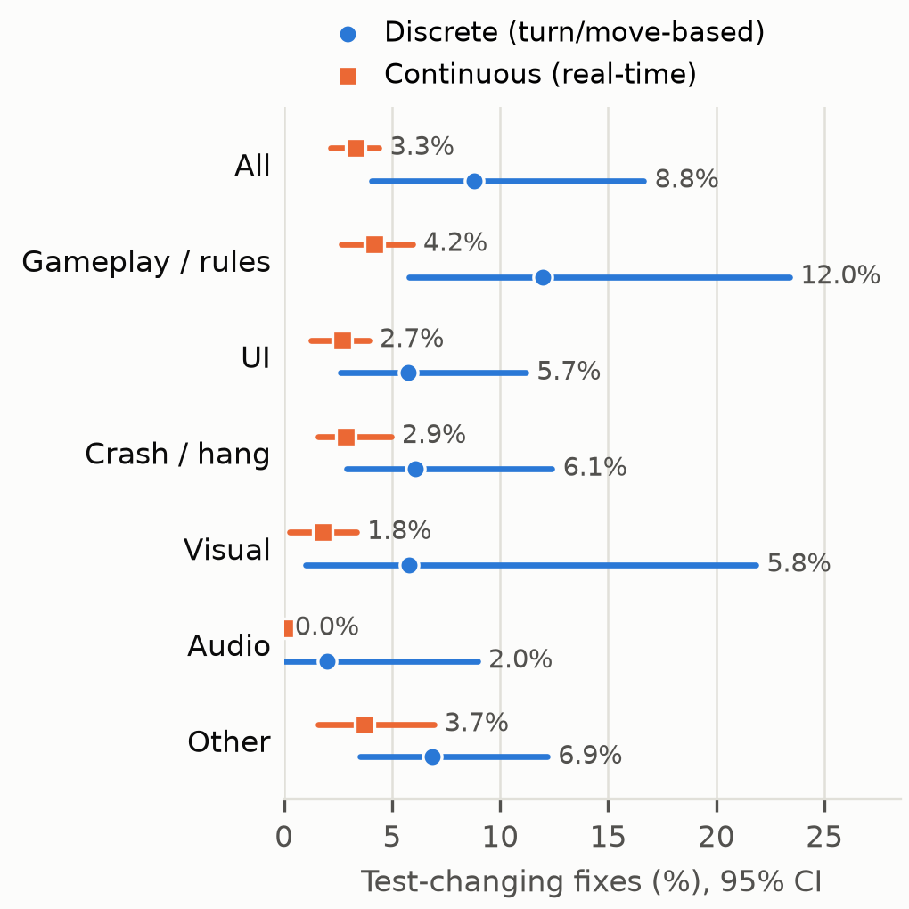

# ゲームの種類とテスト変更（RQ2b、2026-11-14）

問い：**同じ入力から同じ結果になりやすい「離散的な」ゲームは、リアルタイムで進む「連続的な」ゲームより、バグ修正にテストの変更を伴いやすいか。**
既存研究（Murphy-Hill ら ICSE 2014）で開発者が挙げた「非決定性がテストを難しくする」という理由を、データで確かめる位置付け（[既存研究の調査](../related_work_2026-11-14.md)）。

## 分類（`validation/game_type_v1/labels.csv`、`scripts/19_game_type_labels.py`）

本分析の対象 177 プロジェクトを、データセットのトピックと README から分類した。分類者は Claude（claude-opus-5-5）で、**人の確認はまだ**。

| 種類 | 定義 | プロジェクト | Issue |
|---|---|---:|---:|
| 離散的 | 手番、手、ラウンド、選択で進み、行動のときだけ状態が変わる（ボード、カード、チェス、ターン制の戦略、ローグライク、パズル、言葉・クイズ、テキスト、放置系） | 73 | 5,390 |
| 連続的 | リアルタイムで進み、時間、物理、タイミングが関わる（アクション、シューティング、プラットフォーマー、レース、RTS、リズム、リアルタイムのシミュレーション・RPG） | 102 | 4,474 |
| 混合 | 両方が中心（JA2：探索はリアルタイム、戦闘はターン制。MUD） | 2 | 218（比較から除外） |

あわせて、**Web（ブラウザやチャットのボットで遊ぶ）**かどうかも記録した（49 件、うち 40 件が離散的）。Web 開発にはテストを書く文化があるので、その影響を分けるため。

## 結果（`summary.json`、各 CSV、図）



### Issue（修正）の単位

| | テスト変更あり | 割合 | 95% 信頼区間（プロジェクト単位のブートストラップ） |
|---|---:|---:|---|
| 離散的 | 475 / 5,390 | **8.8%** | 4.1–16.7% |
| 連続的 | 148 / 4,474 | **3.3%** | 2.2–4.4% |

- **症状ごとに見ても、どの症状でも離散的なゲームのほうが高い**（ルール 12.0% 対 4.2%、UI 5.7% 対 2.7%、クラッシュ 6.1% 対 2.9%、描画 5.8% 対 1.8%、音声 2.0% 対 0.0%）。
- **同じ種類のゲームの中でも、症状の差は残る**（どちらでもルールが最も高く、音声・描画が低い）。

> **注記（撤回した値）**：下の 2 つの表と箇条書きのオッズ比は `scripts/20_game_type_analysis.py` によるもので、レポートでは使わない。
> とくに完全なモデルの 1.74（0.57–5.32）と Web のオッズ比 7.27 は撤回した。この交換可能相関の当てはめは既定の反復回数で収束しておらず、収束させると推定されたプロジェクト内相関が 0.49 になり、隣り合うモデル指定（0.05–0.09）と大きく異なった。また、統制変数の変更パス数にテストのファイル自体が含まれていた。
> レポートの値は `scripts/27_robustness.py` によるモデル指定の一覧（[../robustness_v1/rq2_spec_grid.csv](../robustness_v1/rq2_spec_grid.csv)）とプロジェクト単位のモデル（[../robustness_v1/rq2_project_level.csv](../robustness_v1/rq2_project_level.csv)）による。完全なモデルのオッズ比は、独立相関で 3.01（0.94–9.59）、交換可能相関で 2.29（1.10–4.76）。

GEE（プロジェクト内の相関を考慮）のオッズ比（離散的 対 連続的）：

| モデル | オッズ比 | 95% 信頼区間 | p |
|---|---:|---|---:|
| 種類だけ | 4.33 | 2.26–8.26 | <0.001 |
| ＋症状 | 3.77 | 1.97–7.20 | <0.001 |
| ＋症状、Web、変更パス数、年、プロジェクトの規模 | 1.74 | 0.57–5.32 | 0.33 |

- **Web かどうかを入れると、差の大部分が説明されてしまう**（Web のオッズ比は 7.27、2.20–24.09）。Web のゲームの多く（49 件中 40 件）が離散的なので、両者を切り離しにくい。
- 感度分析（すべて完全なモデル）：オッズ比は 1.85〜3.10 で、**向きはすべて同じ（離散的が高い）**。ただし、どれも信頼区間が 1 をまたぐ。

| 条件 | 離散的 | 連続的 | オッズ比（95% CI） |
|---|---:|---:|---|
| Web 以外のプロジェクトだけ（126 件） | 7.6% | 3.2% | 1.86（0.71–4.84） |
| テスト変更の多い上位 5 件を除く | 4.1% | 2.9% | 1.95（0.79–4.85） |
| 放置系を除く | 9.1% | 3.3% | 1.93（0.77–4.81） |
| 履歴にテストがあるプロジェクトだけ | 8.9% | 3.4% | 3.10（0.90–10.74） |

### プロジェクトの単位

| | プロジェクト | テストを伴う修正が 1 件以上 | 履歴にテストの変更 | 修正 20 件以上でのテスト変更率の中央値 |
|---|---:|---:|---:|---:|
| 離散的 | 73 | **35（48%）** | 64（88%） | 4.9% |
| 連続的 | 102 | **25（25%）** | 84（82%） | 0.9% |

- ロジスティック回帰（Web と修正件数を調整）：離散的のオッズ比 **2.94（1.19–7.23、p = 0.019）**。
- 離散的なプロジェクトは、**テストで修正を確かめるプロジェクトになりやすい**。プロジェクトの単位では、Web と規模を調整しても差がはっきりしている。

## 解釈

- **観察**：離散的なゲームは、バグ修正にテストの変更を伴う割合が高い（8.8% 対 3.3%）。テストを伴う修正を持つプロジェクトの割合も高い（48% 対 25%）。後者は、Web と規模を調整しても残る。修正の単位の差は、Web を調整するとはっきりしなくなる。
- **説明（仮説）**：
  - 離散的なゲームは、状態を作って操作を流せば同じ結果になる（再現しやすい）。期待される状態をコードで書きやすい（判定しやすい）。
  - Murphy-Hill らが挙げた「非決定性」の理由と合う向きの結果。ただし Web の開発文化という別の説明も同じ向きに働き、データでは切り分けきれない。
  - ターン制のゲームが Web で作られやすいこと自体が、ゲームの種類の結果かもしれない。その場合、Web を調整すると種類の効果を小さく見積もりすぎる。
- **症状と種類は別々に効いている**：どちらの種類でも、音声・描画・UI はテストを伴いにくい。「正しさを判定しにくい症状」と「再現しにくい種類のゲーム」の両方が、テストの少なさに関係している。

## 限界

- 分類は LLM による暫定のもので、人の確認がない。境界の例（放置系、MUD、リアルタイムでも一時停止できるもの）は判断が入っている。
- プロジェクトは 175 件で、上位の数件の影響が大きい。
- 修正の単位の差は、Web を調整すると統計的にははっきりしない。課題文のとおり「明確な差がない」ことも結果として報告する。

## 再現

```
python -I scripts/19_game_type_labels.py validation/game_type_v1/labels.csv
python -I scripts/20_game_type_analysis.py C:/Users/<user>/ossgamebench-data/interim validation/game_type_v1/labels.csv results/game_type_v1
python -I scripts/21_game_type_figure.py results/game_type_v1
```

20 の前に 17_rq_analysis.py を実行して、分析表を作っておく。乱数の種は 20261114。
