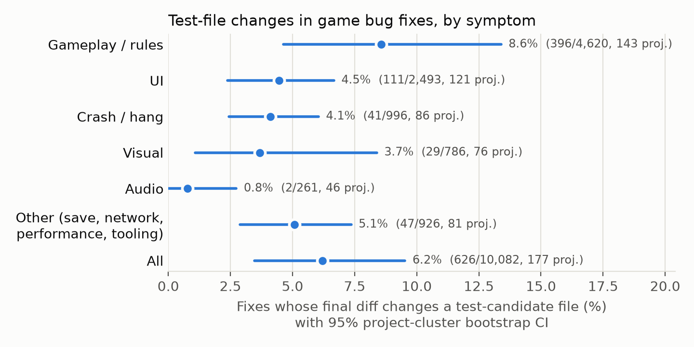
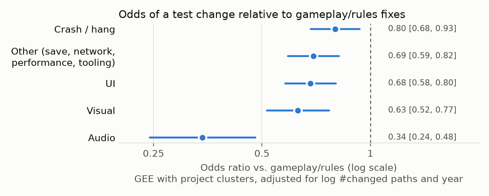
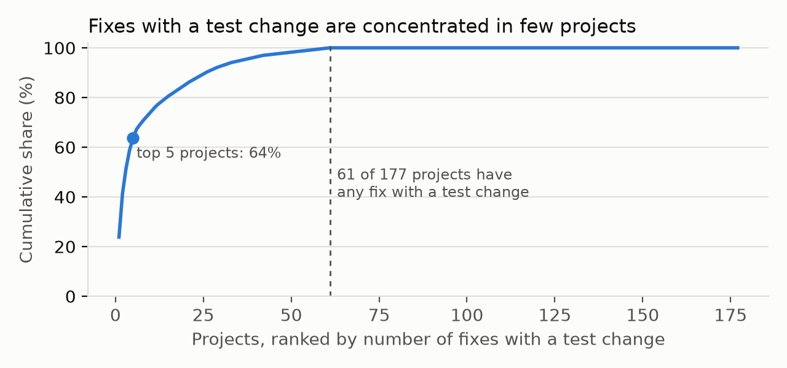

# 本分析 v1：症状ごとのテスト変更（RQ2）と報告の材料（RQ1 の補助）（2026-11-13）

本人の 50 件の判定は後回しにして、LLM の参照判定で規則を検証したうえで本分析を進めた。
人による検証が終わったら、規則の精度と結果をもう一度確認する。

## 対象と指標

- **対象**：game のプロジェクトで、Issue のすべてのマージ済み PR に最終差分があるバグ Issue。**10,082 件、177 プロジェクト**。
- **結果変数**：最終差分にテスト候補パスがあるか（`test_final`）。パスの規則による判定で、テストが実行されたことや、回帰テストであることは示さない。
  内容分析では、テスト候補ありの 30 PR のうち、直接の回帰テストは 14 件だった（[results/test_cases_final_v1](../test_cases_final_v1/README.md)）。
- **症状**：[scripts/symptom_rules.py](../../scripts/symptom_rules.py) のキーワード規則で分類する。
  - まずタイトルを見て、該当がなければ本文を見る。どの規則にも当たらなければ gameplay にする。
  - 規則は development 100 件だけを見て作り、固定した。
  - 件数が少なく規則の精度を確かめられない 4 種類（save_load、network、performance、tooling_other）は、「other」にまとめた。

## 規則の検証（`symptom_rule_evaluation.json`）

| 参照判定 | n | 正解率 | κ | macro-F1 |
|---|---:|---:|---:|---:|
| development（Codex。規則の作成に使った） | 100 | 0.80 | 0.73 | 0.76 |
| **audit（Claude。規則を固定した後に 1 回だけ評価）** | 100 | **0.71** | **0.59** | 0.50 |

- 参照判定は LLM によるもので、人の正解ではない。
- audit のカテゴリ別の詳細は [symptom_rule_evaluation_by_category.json](symptom_rule_evaluation_by_category.json)（2026-11-18 に封印を解除。ハッシュは封印時と一致）。
  crash_hang、ui、gameplay、audio は適合率・再現率とも 0.73 以上だった。
  visual は適合率は高いが再現率が低い（見落としが多い）。other の 4 種類は、audit に該当がほとんどなく評価できない。
- gameplay は「ほかの規則に当たらないもの」なので、性質の異なる不具合が混ざる。

## 結果 1：症状ごとのテスト変更率（`rq2_test_rate_by_symptom.csv`、図 1）



| 症状 | Issue | プロジェクト | テスト変更あり | 割合 | 95% 信頼区間（プロジェクト単位のブートストラップ、2,000 回） |
|---|---:|---:|---:|---:|---|
| gameplay（ルール・状態） | 4,620 | 143 | 396 | **8.6%** | 4.6–13.4% |
| ui | 2,493 | 121 | 111 | 4.5% | 2.4–6.7% |
| crash_hang | 996 | 86 | 41 | 4.1% | 2.4–6.1% |
| visual | 786 | 76 | 29 | 3.7% | 1.1–8.4% |
| audio | 261 | 46 | 2 | **0.8%** | 0.0–2.7% |
| other | 926 | 81 | 47 | 5.1% | 2.9–7.4% |
| 全体 | 10,082 | 177 | 626 | 6.2% | 3.5–9.5% |

- プロジェクトの差を考慮すると信頼区間は広く、ブートストラップの区間は互いに重なる。

## 結果 2：プロジェクトの差を考慮した回帰（`rq2_gee_all.csv`、図 2）



- 方法：GEE（二項、プロジェクト内の交換可能な相関）。共変量は、症状（基準 gameplay）、log(変更パス数 + 1)、報告年。

| 症状（対 gameplay） | オッズ比 | 95% 信頼区間 |
|---|---:|---|
| crash_hang | 0.80 | 0.68–0.93 |
| other | 0.69 | 0.59–0.82 |
| ui | 0.68 | 0.58–0.80 |
| visual | 0.63 | 0.52–0.77 |
| audio | 0.34 | 0.24–0.48 |

- 変更パス数のオッズ比は 2.08（1.75–2.48）。大きな修正ほどテストの変更を含みやすい。報告年の効果ははっきりしない（0.97、p = 0.40）。
- 同じプロジェクトの中で比べても、gameplay はほかの症状よりテスト変更を伴いやすい。
  - 18xx：11.5% 対 ui 9.4%
  - mage：62% 対 ui 19%
  - vcmi：12.7% 対 crash 6.2%、ui 6.2%
  - 例外は space-station-14 で、どの症状もほぼ同じだった。
- 履歴にテスト候補の変更があるプロジェクト（150 件、9,897 Issue）に限っても、結果はほぼ同じ（`rq2_gee_projects_with_tests.csv`）。

## 結果 3：テストの変更は少数のプロジェクトに集中（図 3）



- テスト変更を伴う修正が 1 件でもあるプロジェクトは、177 件中 **61 件**だけ。
- テスト変更を伴う修正の **64%** は、上位 5 プロジェクトから来ている（18xx 149、mage 110、vcmi 63、space-station-14 46、cuttle 31）。
- 修正が 20 件以上あるプロジェクト（53 件）でも、テスト変更率の中央値は 1.9%。fheroes2（1,262 件）は 0 件だった。

## 感度分析（`summary.json` の `sensitivity_rates`）

| 条件 | gameplay | ui | crash | visual | audio | other | 全体 |
|---|---:|---:|---:|---:|---:|---:|---:|
| 主分析 | 8.6% | 4.5% | 4.1% | 3.7% | 0.8% | 5.1% | 6.2% |
| 上位 3 プロジェクトを除く（6,481 件） | 9.8% | 4.7% | 4.2% | 4.7% | 1.2% | 5.1% | 6.7% |
| 1 つの Issue だけを閉じる PR に限る（8,229 件） | 7.6% | 3.5% | 3.1% | 2.9% | 0.0% | 4.0% | 5.3% |
| 履歴にテストがあるプロジェクトに限る（9,897 件） | 8.7% | 4.5% | 4.3% | 3.8% | 0.8% | 5.1% | 6.3% |

- どの条件でも、gameplay が最も高く、audio が最も低いという順序は変わらなかった。

## 補助：報告の材料（`rq1_report_material_by_symptom.csv`）

本文の文字列による粗い規則で判定した（未検証）。同じ 10,082 件が対象。

| 症状 | 画像 | 動画 | セーブ・添付 | ログ・トレース | 再現手順 | 対局などへのリンク |
|---|---:|---:|---:|---:|---:|---:|
| gameplay | 32% | 3% | 11% | 6% | 13% | 14% |
| ui | 49% | 4% | 8% | 2% | 18% | 9% |
| crash_hang | 19% | 1% | 18% | **31%** | 22% | 2% |
| visual | **55%** | 7% | 10% | 3% | 15% | 2% |
| audio | 25% | 9% | 11% | 4% | 18% | 0% |
| 全体 | 36% | 4% | 11% | 8% | 16% | 10% |

- テストの変更が少ない visual と ui の報告には、画像が多く付いている。テストの変更が少ない crash の報告には、ログやスタックトレースが多い。
  しかし内容分析では、画像がテストに使われた例はなかった。
- 画像付きの報告はテスト変更率が低い（3.8% 対 7.5%）。ただし症状とプロジェクトの違いを調整していない、記述的な比較。
- 対局などへのリンク（18xx などの対局 URL）がある報告は 8.1% 対 6.0%。18xx#2558 のように、対局の記録がテストデータになった例とつながる。

## 解釈の注意（観察・説明・提案の区別）

- **観察**：リンクされた最終差分でのテスト候補パスの変更率。テストがないこと、テストが不要だったこと、別の PR で書かれたことは区別できない。
- **説明（仮説）**：gameplay（ルール）は、状態と期待値をコードで書きやすく、ターン制のボードゲームやカードゲームのように決定的なシミュレーションがあるプロジェクトに多い。
  audio・visual は、出力を自動で判定する方法（オラクル）を作りにくい。いずれもデータでは確かめていない。
- **偏り**：
  - 症状の分類は規則によるもので、audit での κ は 0.59。
  - gameplay は「ほかに当たらないもの」を含む。
  - プロジェクトの範囲（game）は LLM による暫定の分類。
  - 修正までたどれる Issue に限られる。
  - 少数のプロジェクトの影響が大きい。

## 再現

```
python -I scripts/16_evaluate_symptom_rules.py validation/samples_game_v3/issues_llm.jsonl validation/samples_game_v3/development_labels.jsonl <audit_labels> results/rq_analysis_v1/symptom_rule_evaluation.json <sealed_details>
python -I scripts/17_rq_analysis.py C:/Users/<user>/ossgamebench-data/interim results/rq_analysis_v1
python -I scripts/18_figures.py results/rq_analysis_v1
```

17 の前に、07 → 08 → 11 を実行しておく（[CHECKPOINT.md](../../CHECKPOINT.md)）。乱数の種は 20261113。
